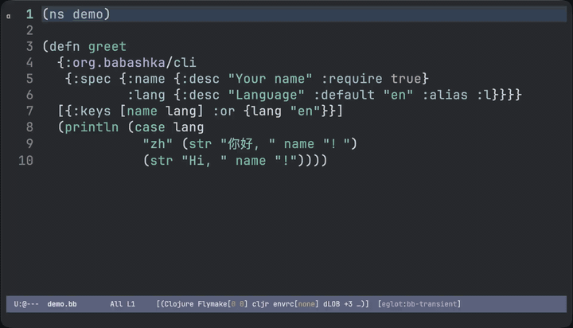

# bb-transient

Transient menus for [babashka](https://github.com/babashka/babashka) tasks.



## Why?

Babashka tasks [recently][bb-changelog] gained [subcommands and
switches][bb-tasks]. This means that tasks can now be full-blown
project CLIs.

Full-blown CLIs get complex pretty quickly. Babashka already supports
completion for various shells (bash, fish, zsh, etc), to help you
construct complex commands and avoid typos.

This project serves a similar purpose. It analyzes babashka's CLI spec
and generates an Emacs [transient][transient] menu. It lets you
explore subcommands, set CLI options, and view command output.

This library is created with AI assistance. If you notice any bugs,
please open a Github ticket.

[bb-changelog]: https://github.com/babashka/babashka/blob/master/CHANGELOG.md#113219-2026-07-27
[bb-tasks]: https://blog.michielborkent.nl/babashka-tasks-cli.html
[transient]: https://github.com/magit/transient

## Installation

```
(use-package bb-transient
  :vc (:url "https://github.com/kpassapk/bb-transient")
  :commands bb-transient)
```

Most of the configuration goes in `bb.edn`, which is read by _both
babashka and Emacs_ (via [cljbang][cljbang]). If cljbang can't read it,
then it should go in =:bb-transient/cljbang-paths=.

```clojure
{:paths ["src"]

  :bb-transient/cljbang-paths ["emacs"]
  :tasks {
    :init {:exec-fn tasks/init   :bb-transient/after 'hooks/open-project
    :watch {:exec-fn tasks/watch :bb-transient/terminal true}}

  :bb-transient/defaults
  {:id   (el/org-entry-get nil "ID" true)}}
```

## Usage

`M-x bb-transient` opens a menu.  Tasks with a `:cmd` table open
a submenu; commands with a `babashka.cli` spec open an options menu;
anything else runs as soon as its key is pressed.  Commands run from
the project root in a `compilation-mode` buffer named `*bb
<command>*`.

## How the menus are built

`bb-transient.clj` walks `:tasks` and nested `:cmd` tables in file
order, resolves each `:exec-fn`, and reads the `:spec` from its
`:org.babashka/cli` metadata:

| spec                 | menu                                     |
|----------------------|------------------------------------------|
| `:coerce :boolean`   | switch `--flag`                          |
| anything else        | option `--name=`                         |
| `:alias :t`          | key `-t`, when free                      |
| `:require true`      | marked "(required)", checked before run  |
| `:default x`         | shown as "(default x)"                   |

Every options menu also has `-=` for extra arguments, split like a
shell command line, for flags the spec doesn't declare.

Tasks named `-foo` or marked `:private true` are left out.  The tree is
cached per project and re-read when `bb.edn` changes; `g` in the top
menu re-reads it after you edit a spec in a `.clj` file.

## Setup

```elisp
(use-package bb-transient
  :vc (:url "https://github.com/kpassapk/bb-transient")
  :commands bb-transient)
```

Optionally add it to `project-switch-commands`:

```elisp
(add-to-list 'project-switch-commands '(bb-transient "bb tasks" ?b))
```

`bb-transient-use-comint` (default `t`) runs commands in comint mode so
they can read input; `bb-transient-program` is the bb executable.

## TUIs

Commands that draw a full-screen UI need a real terminal.  Mark them
with `:bb-transient/terminal true`, on the fn or in the task map:

```clojure
(defn top
  {:bb-transient/terminal true}
  [_] ...)
```

```clojure
watch {:bb-transient/terminal true :exec-fn tasks/watch}
```

They run in an interactive [ghostel][ghostel] `ghostel-compile` buffer,
which still ends up a compilation buffer (`g` reruns, `next-error`
works) once the command exits.  Everything else runs in
`compilation-mode` as usual.  `t` in an options menu toggles the
terminal for one run, and a prefix argument (`C-u`) does the same for
commands that run as soon as their key is pressed.  ghostel is only
needed if you use this.

[ghostel]: https://github.com/dakra/ghostel

## Layers

A menu can hold other projects' tasks too, a group per project: the
current project's tasks first, then the other projects', the outermost
last.  Each function in `bb-transient-layers-functions` gets the current
project's directory and returns `(LABEL . DIRECTORY)` pairs, outermost
first:

```elisp
(add-hook 'bb-transient-layers-functions
          (lambda (_root) '(("shared" . "~/src/shared-tasks/"))))
```

- Every command runs from the current project.  Another project's task
  runs as `bb --config <that project>/bb.edn <task>`, so its `:paths` and
  `:deps` still resolve.
- A task in an inner project hides an outer project's task of the same
  name.  `:cmd` tables aren't merged.
- The outermost project's tasks get keys first, so a parent's keys are
  the same in every project that uses it.  `g` re-reads every project.
- A function that returns the current project itself labels its group.

`bb-transient-directory-function` decides where commands run (the
project root by default); `(lambda () default-directory)` runs them from
the buffer's directory instead.  From Lisp, `bb-transient-run` runs a task
without the menu and `bb-transient-tasks` returns a project's task tree.

## Defaults from point

An options menu can open with options already filled in from where
point is.  `:bb-transient/defaults` in bb.edn maps option names to
[cljbang][cljbang] forms, evaluated in the buffer the menu was opened
from:

```clojure
{:paths ["src"]
 :bb-transient/defaults
 {:id   (el/org-entry-get nil "ID" true)
  :book (some->> (el/buffer-file-name)
                 (re-find (re-pattern "--\\([^/_.]+\\)"))
                 second)}
 :tasks {...}}
```

- A key fills that option in every command from this bb.edn that has
  it, and is ignored by the rest.  Other projects' commands in the same
  menu (see Layers) use their own bb.edn's.
- The same key in a task map, or quoted on an `:exec-fn`'s metadata
  (`{:bb-transient/defaults {:id '(...)}}`), wins for that command.
- `nil` leaves the option blank; an error does too, with a message.  A
  non-nil result turns a boolean option on.
- A filled value replaces the one transient remembers from the last
  run, and counts for "(required)".
- Forms run inside Emacs.  `bb-transient-eval-hooks` is `ask` (once per
  project and session) by default; `t` or `nil` to always or never.
- Without cljbang, defaults are skipped with a message.

Of course, `bb` reads `bb.edn` too, which limits what a form can say:

| Form           | In bb.edn                                          |
|----------------|----------------------------------------------------|
| `(el/f ...)`   | fine                                               |
| `'x`           | fine                                               |
| `(fn [m] ...)` | fine                                               |
| `#"..."`       | rejected by bb; use `re-pattern`, which takes Emacs regex syntax |
| `#(...)`       | not cljbang either; use `fn`                       |

A form longer than a couple of lines reads better in a cljbang file
called from bb.edn.

## Copying a command

A command run from a menu leaves no trace an agent can read. `w` copies
the command line instead of running it:

- In an options menu, `w` copies what `RET` would run, with the defaults
  from point filled in. The before hook is not called, as it can have
  effects.
- A bare leaf runs on its key, so in the top menu `w` turns on "copy
  instead of run" for the next command picked, in any submenu. It is
  cleared when the menu exits.
- From Lisp, `(bb-transient-command-line PATH ARGS)` returns the string.

## Project function

Which project's menu opens is up to `bb-transient-project-function`
(the nearest bb.edn by default).  Commands run from that project too.
E.g. from an Org entry's `:REPO:` property:

```elisp
(setq bb-transient-project-function
      (lambda ()
        (or (and (derived-mode-p 'org-mode)
                 (clj! (some-> (el/org-entry-get nil "REPO" true) el/expand-file-name)))
            (bb-transient-project-root))))
```

## Hooks

A command can run cljbang before it starts and after it exits.  E.g.
after `work start`, open the new workbook it prints:

```clojure
(defn start
  {:org.babashka/cli {...}
   :bb-transient/before 'forge.hooks/save-book
   :bb-transient/after  'forge.hooks/open-book}
  [opts] ...)
```

```clojure
;; emacs/forge/hooks.clj
(ns forge.hooks
  (:require [clojure.string :as str]))

(defn save-book [_]
  (el/save-some-buffers true)
  nil)

(defn open-book [{:keys [exit out]}]
  (when (zero? exit)
    (el/find-file (el/expand-file-name "workbook.org"
                                       (-> out str/trim str/split-lines last)))))
```

and in bb.edn, where to find `forge.hooks`:

```clojure
{:bb-transient/cljbang-paths ["emacs"]
 :tasks {...}}
```

- `:bb-transient/before` is called with `{:args [...] :dir "..."}` in
  the buffer the menu was opened from, just before the command starts.
  It returns new args, or `nil` to keep them.  If it throws, the
  command doesn't run and the error is shown as a message.
- `:bb-transient/after` is called with `{:exit 0 :out "..." :buffer
  <output buffer> :args [...]}` when the process exits, failed or not,
  in the original buffer if it is still live, otherwise in the output
  buffer.  `:out` is what the command wrote, without compile's header
  and footer; in a terminal it is the whole buffer.
- `:args` are the strings bb gets, e.g. `"--book=sandboxes"`.
- A hook is a qualified symbol, whose namespace is required from
  `:bb-transient/cljbang-paths` (directories relative to the project),
  or an `(fn ...)` form for a one-liner.
- Hooks belong to one command, in its task map or, quoted, on its
  `:exec-fn`'s metadata; the task map wins.  A plain `:task` can have
  them too.
- Only commands run from a menu get hooks, not `bb-transient-run`.
- They're trusted like defaults (`bb-transient-eval-hooks`).  When a
  project isn't trusted, or cljbang is missing, the command runs
  without them.  `g` recompiles them and requires their namespaces
  again.

[cljbang]: https://github.com/kpassapk/cljbang.el

## Development

```
bb ci      # byte-compile (warnings are errors), then the ERT suite
```

The tests need `bb` on `PATH`; they introspect and run the project in
`test/fixture`.  Set `CLJBANG` to cljbang's directory to run the
defaults tests too; without it they skip.
