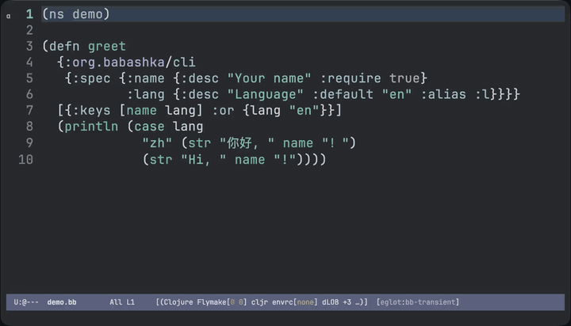

# bb-transient

Transient menus for [babashka](https://github.com/babashka/babashka) tasks.



## Why?

Babashka tasks [recently][bb-changelog] gained [subcommands and
switches][bb-tasks]. This means that tasks can now be full-blown
project CLIs.

Full-blown CLIs get complex pretty quickly. Babashka already supports
completion for various shells (bash, fish, zsh, etc), to help you quickly
construct complex commands and avoid typos.

This project serves a similar purpose. It analyzes babashka's CLI spec
and generates an Emacs [transient][transient] menu. It lets you
explore subcommands, set CLI options, and view command output.

This library is created with AI assistance. If you notice any bugs,
please open a Github ticket.

[bb-changelog]: https://github.com/babashka/babashka/blob/master/CHANGELOG.md#113219-2026-07-27
[bb-tasks]: https://blog.michielborkent.nl/babashka-tasks-cli.html
[transient]: https://github.com/magit/transient

## Usage

`M-x bb-transient` in any buffer under a project with a `bb.edn` opens a
menu of its tasks.  Tasks with a `:cmd` table open a submenu; commands
with a babashka.cli spec open an options menu; anything else runs as
soon as its key is pressed.  Commands run from the project root in a
`compilation-mode` buffer named `*bb <command>*`.

## How the menus are built

bb reads the tree, not `--help`.  `bb-transient.clj` runs under the
project's own `bb.edn` (so its `:paths` and `:deps` are on the
classpath), walks `:tasks` and nested `:cmd` tables in file order,
resolves each `:exec-fn`, and reads the `:spec` from its
`:org.babashka/cli` metadata:

| spec                 | menu                                     |
|----------------------|------------------------------------------|
| `:coerce :boolean`   | switch `--flag`                          |
| anything else        | option `--name=`                         |
| `:alias :t`          | key `-t`, when free                      |
| `:require true`      | marked "(required)", checked before run  |
| `:default x`         | shown as "(default x)"                   |

Every options menu also has `-=` for extra arguments, split like a
shell command line, for flags the spec doesn't declare.

Tasks named `-foo` or marked `:private true` are left out.  The tree is
cached per project and re-read when `bb.edn` changes; `g` in the top
menu re-reads it after you edit a spec in a `.clj` file.

## Setup

```elisp
(use-package bb-transient
  :vc (:url "https://github.com/kpassapk/bb-transient")
  :commands bb-transient)
```

Optionally add it to `project-switch-commands`:

```elisp
(add-to-list 'project-switch-commands '(bb-transient "bb tasks" ?b))
```

`bb-transient-use-comint` (default `t`) runs commands in comint mode so
they can read input; `bb-transient-program` is the bb executable.

## TUIs

Commands that draw a full-screen UI need a real terminal.  Mark them
with `:bb-transient/terminal true`, on the fn or in the task map:

```clojure
(defn top
  {:bb-transient/terminal true}
  [_] ...)
```

```clojure
watch {:bb-transient/terminal true :exec-fn tasks/watch}
```

They run in an interactive [ghostel][ghostel] `ghostel-compile` buffer,
which still ends up a compilation buffer (`g` reruns, `next-error`
works) once the command exits.  Everything else runs in
`compilation-mode` as usual.  `t` in an options menu toggles the
terminal for one run, and a prefix argument (`C-u`) does the same for
commands that run as soon as their key is pressed.  ghostel is only
needed if you use this.

[ghostel]: https://github.com/dakra/ghostel

## Development

```
bb ci      # byte-compile (warnings are errors), then the ERT suite
```

The tests need `bb` on `PATH`; they introspect and run the project in
`test/fixture`.
