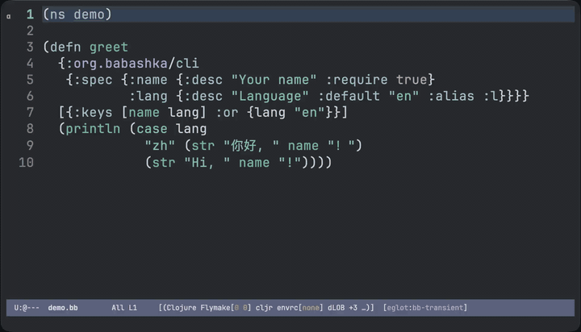

# bb-transient

Emacs [transient][transient] menus for [babashka](https://github.com/babashka/babashka) tasks.



Babashka tasks [recently][bb-changelog] gained [subcommands and
switches][bb-tasks], so a `bb.edn` can now be a full project CLI.
bb-transient reads that CLI's spec and turns it into a menu: browse
subcommands, set options, and see the output.

This library is written with AI assistance. If you find a bug, please
open an issue.

[bb-changelog]: https://github.com/babashka/babashka/blob/master/CHANGELOG.md#113219-2026-07-27
[bb-tasks]: https://blog.michielborkent.nl/babashka-tasks-cli.html
[transient]: https://github.com/magit/transient

## Installation

```elisp
(use-package bb-transient
  :vc (:url "https://github.com/kpassapk/bb-transient")
  :commands bb-transient)

;; Optional: add it to `project-switch-project'
(add-to-list 'project-switch-commands '(bb-transient "bb tasks" ?b))
```

Some features (defaults from point, hooks) also need
[cljbang][cljbang]. [ghostel][ghostel] is needed only for terminal
commands.

## Usage

`M-x bb-transient` opens a menu of the nearest `bb.edn`'s tasks:

- a task with a `:cmd` table opens a submenu,
- a command with a `babashka.cli` spec opens an options menu,
- anything else runs as soon as its key is pressed.

Commands run from the project root in a `*bb <command>*`
compilation buffer.

The options menu is built from the `:spec` in each `:exec-fn`'s
`:org.babashka/cli` metadata:

| Spec               | Menu                                    |
|--------------------|-----------------------------------------|
| `:coerce :boolean` | switch `--flag`                         |
| anything else      | option `--name=`                        |
| `:alias :t`        | key `-t`, if free                       |
| `:require true`    | marked "(required)", checked before run |
| `:default x`       | shown as "(default x)"                  |

Tasks named `-foo` or marked `:private true` are hidden.

### Keys

| Key   | Where        | Does                                                   |
|-------|--------------|--------------------------------------------------------|
| `-=`  | options menu | extra arguments, split like a shell command line       |
| `t`   | options menu | toggle running in a terminal, for this run             |
| `s`   | options menu | toggle silent, for this run                            |
| `_`   | options menu | copy the command line instead of running it            |
| `_`   | top menu     | copy instead of run for the next command picked        |
| `C-u` | any menu     | run a bare command (no options menu) in a terminal     |
| `g`   | top menu     | re-read the task tree (after editing a spec in `.clj`) |

The tree is cached per project and re-read automatically when `bb.edn`
changes.

## Task options

These keys go in a task map or on the `:exec-fn`'s metadata (the task
map wins). Hooks and defaults on metadata must be quoted.

```clojure
{:bb-transient/cljbang-paths ["emacs"]          ; where hook namespaces live
 :bb-transient/defaults {:id (el/org-entry-get nil "ID" true)}
 :tasks
 {watch    {:exec-fn tasks/watch    :bb-transient/terminal true}
  serve    {:exec-fn tasks/serve    :bb-transient/singleton true}
  snapshot {:exec-fn work/snapshot  :bb-transient/silent true}
  init     {:exec-fn tasks/init     :bb-transient/after forge.hooks/open-project}}}
```

| Key                       | Effect                                       |
|---------------------------|----------------------------------------------|
| `:bb-transient/terminal`  | run in a real terminal (for TUIs)            |
| `:bb-transient/singleton` | only one running copy                        |
| `:bb-transient/silent`    | show output only on failure or a prompt      |
| `:bb-transient/before`    | cljbang hook called before the command       |
| `:bb-transient/after`     | cljbang hook called after the command exits  |
| `:bb-transient/defaults`  | fill options from where point is             |

### Terminal

Full-screen UIs run in an interactive [ghostel][ghostel]
`ghostel-compile` buffer. Once the command exits it behaves like any
compilation buffer (`g` reruns, `next-error` works).

### Singleton

For dev servers and watchers. If the command is still running, running
it again just shows its buffer; options are ignored and no hook is
called. A singleton is identified by its task path, so `serve --port=1`
and `serve --port=2` are the same one.

### Silent

The buffer stays hidden:

- exit 0 shows a message, `bb snapshot: done`;
- any other exit pops up the buffer and points `next-error` at it;
- a line with no trailing newline and no output for 0.3 s is taken
  as a prompt and pops up the buffer.

The prompt check is a guess. A prompt ending in a newline, or one that
isn't flushed (`print` without `flush`), goes unseen and the command
waits in the hidden buffer. A progress line ending in `\r` pops it up
for nothing. Terminal commands are never silent.

### Defaults from point

`:bb-transient/defaults` maps option names to [cljbang][cljbang] forms,
evaluated in the buffer the menu was opened from. A top-level map
applies to every command that has that option.

```clojure
:bb-transient/defaults
{:id   (el/org-entry-get nil "ID" true)
 :book (some->> (el/buffer-file-name)
                (re-find (re-pattern "--\\([^/_.]+\\)"))
                second)}
```

- `nil` or an error leaves the option blank; a non-nil value turns a
  boolean on.
- A filled value replaces the one transient remembered, and satisfies
  "(required)".
- `bb` reads `bb.edn` too, so `#"..."` and `#(...)` aren't allowed. Use
  `re-pattern` (Emacs regex syntax) and `fn`. Longer forms read better
  in a cljbang file.

### Hooks

A hook is a qualified symbol, required from
`:bb-transient/cljbang-paths`, or an inline `(fn ...)`.

```clojure
;; emacs/forge/hooks.clj
(ns forge.hooks
  (:require [clojure.string :as str]))

(defn save-book [_]
  (el/save-some-buffers true)
  nil)

(defn open-book [{:keys [exit out]}]
  (when (zero? exit)
    (el/find-file (el/expand-file-name "workbook.org"
                                       (-> out str/trim str/split-lines last)))))
```

- **before** gets `{:args [...] :dir "..."}` in the original buffer. It
  returns new args, or `nil` to keep them. If it throws, the command
  doesn't run.
- **after** gets `{:exit 0 :out "..." :buffer <buf> :args [...]}` when
  the process exits, in the original buffer if still live. `:out` is the
  command's output (in a terminal, the whole buffer).
- Only commands run from a menu get hooks, not `bb-transient-run`.

### Line functions

`bb-transient-line-functions` rewrites a command line before it is
copied or run. Each function gets the line as a list of words and a
plist, and returns new words, or `nil` to leave them alone:

```elisp
(add-hook 'bb-transient-line-functions
          (lambda (words info)
            (when (eq (plist-get info :mode) 'copy)
              (cons "aa" (append (plist-get info :path) (plist-get info :args))))))
```

- **INFO** has `:mode` (`copy` or `run`), `:path`, `:args`, `:root`,
  `:dir` and `:layers`, the `(LABEL . DIR)` list of the open menu, or the
  project's when there is none.
- Functions run in order, each seeing the previous one's words. A run
  sees them after the `before` hook, with the args it returned.
- Words are quoted and joined last, so a function never quotes.
- A function that signals: a copy falls back to the line without the
  rewrite, and a message says why; a run doesn't run, and the message
  names the function.
- `bb-transient-command-line` uses `:mode run`.

### Trust

Defaults and hooks run code inside Emacs. `bb-transient-eval-hooks` is
`ask` (once per project per session) by default; set it to `t` or `nil`
to always or never allow. Untrusted projects, or a missing cljbang, run
commands without them.

## Customization

| Variable                          | Default                     | Purpose                              |
|-----------------------------------|-----------------------------|--------------------------------------|
| `bb-transient-program`            | `"bb"`                      | bb executable                        |
| `bb-transient-use-comint`         | `t`                         | let commands read input              |
| `bb-transient-project-function`   | nearest `bb.edn`            | which project's menu opens           |
| `bb-transient-directory-function` | project root                | where commands run                   |
| `bb-transient-eval-hooks`         | `ask`                       | trust for defaults and hooks         |
| `bb-transient-layers-functions`   | `nil`                       | other projects' tasks in the menu    |
| `bb-transient-line-functions`     | `nil`                       | rewrite a line before copy or run    |

### Layers

Show tasks from other projects in the same menu, a group per project.
Each function gets the current project root and returns
`(LABEL . DIRECTORY)` pairs, outermost first:

```elisp
(add-hook 'bb-transient-layers-functions
          (lambda (_root) '(("shared" . "~/src/shared-tasks/"))))
```

Every command runs from the current project, as `bb --config
<other>/bb.edn <task>`. Inner tasks hide outer ones of the same name
(`:cmd` tables aren't merged). Outer projects get keys first, so shared
keys stay stable across projects.

### Lisp API

- `(bb-transient-run PATH &optional ARGS PROJECT TERMINAL SILENT)` runs a task.
- `(bb-transient-command-line PATH &optional ARGS PROJECT)` returns the command string, as a run would use it (after `bb-transient-line-functions`).
- `(bb-transient-tasks ROOT)` returns a project's task tree.

[cljbang]: https://github.com/kpassapk/cljbang.el
[ghostel]: https://github.com/dakra/ghostel

## Development

```sh
bb ci      # byte-compile (warnings are errors), then the ERT suite
```

Tests need `bb` on `PATH`. Set `CLJBANG` to cljbang's directory to run
the defaults tests too.
